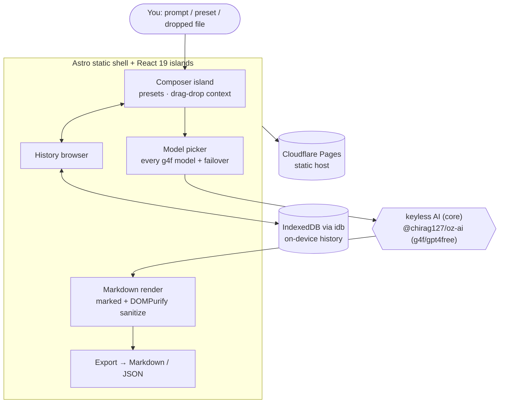

# oriz-chat

> Free client-side AI chat — multi-turn, model picker, markdown, IndexedDB history, presets, export. No signup, runs in your browser.

[](LICENSE)
[](https://github.com/chirag127/oriz-chat/stargazers)
[](https://github.com/chirag127/oriz-chat/commits)
[](https://astro.build)

**Live app:** https://chat.oriz.in · **About:** https://chirag127.github.io/oriz-chat/ · **Repo:** https://github.com/chirag127/oriz-chat

A free, streaming AI chat that runs entirely in your browser — no signup, no API key, no server. Multi-turn conversations with a full model picker and automatic multi-provider failover, sanitized markdown rendering, on-device history in IndexedDB, prompt presets, and export. The only network calls are the AI completion requests you initiate; conversations are saved locally and never touch a backend.

⭐ If this is useful, please [star the repo](https://github.com/chirag127/oriz-chat/stargazers) — it helps others find it.

## How it works



## Features

- **Streaming chat** — token-by-token responses via `@chirag127/oz-ai` (keyless g4f, no API key).
- **Model picker** — every g4f model, with automatic failover if a provider is down.
- **Prompt presets** — general, code, brainstorm, explain, rewrite, translate (system prompts).
- **Markdown render** — sanitized markdown + fenced code, tables, lists (`marked` + `DOMPurify`, lazy-loaded).
- **Private history** — conversations persisted in IndexedDB (`idb`); browse, reopen, delete.
- **Export** — download any conversation as Markdown or JSON.
- **Drag & drop** — drop a `.txt`/`.md` file into the composer to load it as context.
- **Accessible + responsive** — WCAG-AA contrast, keyboard nav, mobile (390px) → desktop (1440px).
- **PWA-installable** — offline app shell.

## Tech stack

- **Astro 6** static output.
- **React 19** islands.
- **Tailwind CSS v4** with a bespoke per-site theme.
- **[marked](https://marked.js.org/)** + **[DOMPurify](https://github.com/cure53/DOMPurify)** — markdown render + sanitize (lazy-loaded).
- **[idb](https://github.com/jakearchibald/idb)** — IndexedDB wrapper for on-device history.
- **Shared `@chirag127/oz-*` packages** — `oz-ai` (keyless g4f/gpt4free AI, multi-provider failover), `oz-file`, `oz-tokens-base`, `oz-chrome`.
- **Vitest** unit tests + **Playwright** end-to-end tests.
- **Cloudflare Pages** — static hosting.

## Repo structure

```
oriz-chat/
├── src/
│   ├── pages/          # Astro routes (chat UI)
│   ├── components/      # React islands (composer, picker, render, history)
│   ├── lib/            # AI client wrapper, idb store, markdown/sanitize, export
│   ├── layouts/        # base HTML layout / meta
│   └── styles/         # Tailwind v4 entry + theme tokens
├── tests/             # Vitest specs + Playwright e2e
├── public/            # static assets, icons, manifest
└── astro.config.mjs   # Astro config
```

## Screenshots

See the live app in action at **https://chat.oriz.in**.

## Quick start

```bash
npm install --legacy-peer-deps
npm run dev       # local dev server
npm run test      # vitest unit tests (+ Playwright e2e)
npm run build     # static build → dist/
npm run deploy    # build + wrangler pages deploy (Cloudflare Pages)
```

> Windows: use **npm** (pnpm skips `@esbuild/win32-x64` and the Astro build crashes).

## Configuration

Fully client-side — **no environment variables required**. AI uses `@chirag127/oz-ai` (keyless g4f/gpt4free with multi-provider failover), so there is no API key to configure.

## Part of the oriz family

One of ~80 sites in the [oriz](https://blog.oriz.in) family — a fleet of small, fast, client-side tools that run **$0 on the Cloudflare free tier**.

> **Hosting:** the canonical live app is served from **Cloudflare Pages** at [chat.oriz.in](https://chat.oriz.in). GitHub Pages serves a separate info/landing page at [chirag127.github.io/oriz-chat](https://chirag127.github.io/oriz-chat/), published from `gh-info/`.

## Related projects

- [oriz-text](https://github.com/chirag127/oriz-text) — writing-desk text toolkit (also has optional AI polish).
- [oriz-color](https://github.com/chirag127/oriz-color) — color studio.
- [oriz-img](https://github.com/chirag127/oriz-img) — in-browser image toolkit.
- [oriz-finance](https://github.com/chirag127/oriz-finance) — finance calculators.

## Contributing

Issues and PRs welcome. Conventional commits are the changelog.

## Status

Stable.

## License

MIT © 2026 Chirag Singhal · chirag@oriz.in
